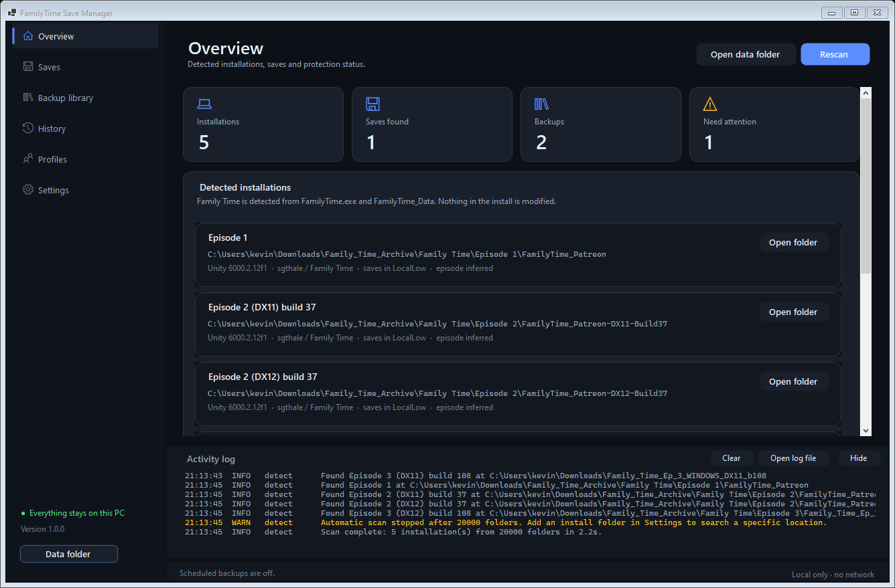
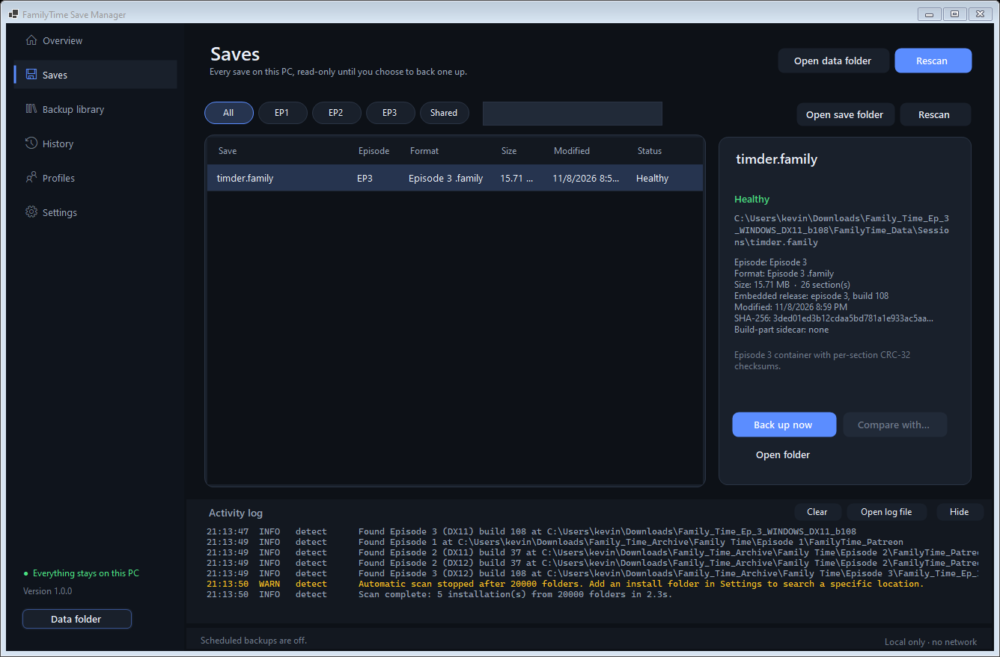
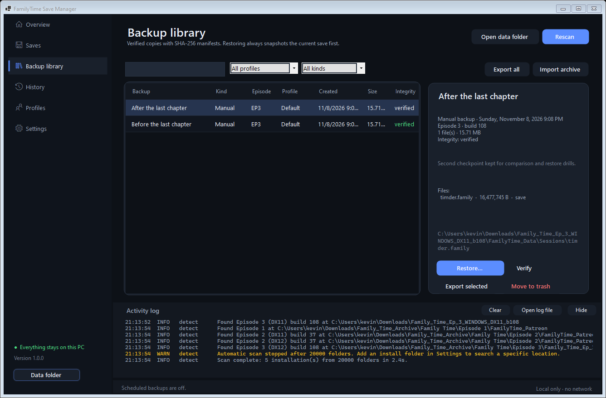
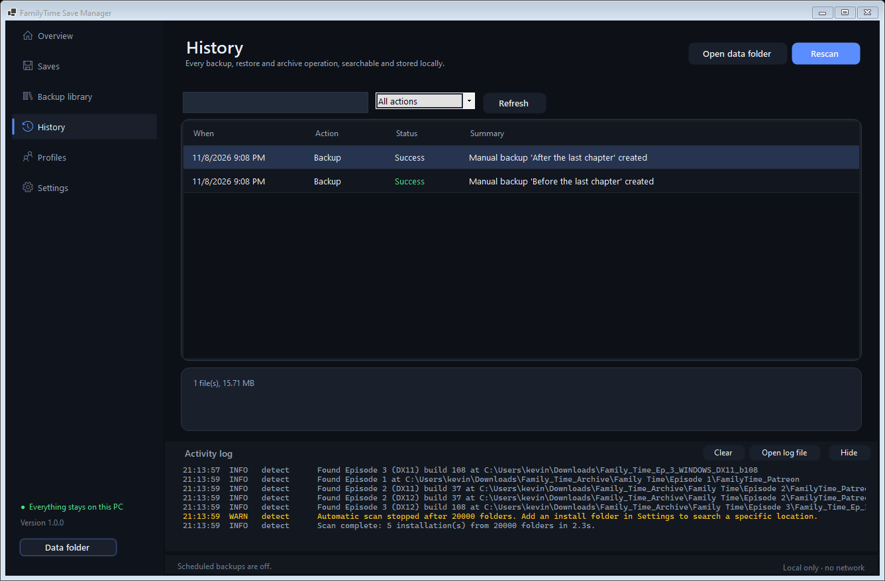
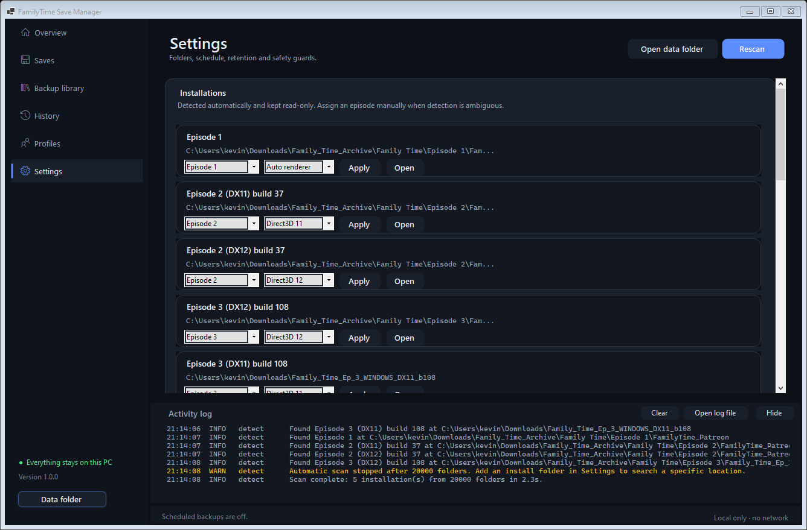

# FamilyTime Save Manager

A local, offline save manager for **Family Time Episodes 1–3** on Windows 10 and 11.
It finds your installations and save folders, lists every save with verified metadata, makes
checksum-verified backups, restores them with a mandatory recovery snapshot, and keeps a
searchable history. Nothing is uploaded and no game file is ever modified.



## What it does

- **Detects installations automatically** — `FamilyTime.exe` + `FamilyTime_Data`, with episode
  and renderer inferred from the build layout and the save format inside the assembly.
- **Finds real save folders** — Episode 3 keeps saves inside the install; Episodes 1 and 2 use
  Unity's shared LocalLow folder. Manual overrides are available in Settings.
- **Lists saves read-only** with episode, format, size, timestamps, embedded build label,
  section count and SHA-256. Parsing never writes to a save.
- **Verifies integrity** — Episode 3 containers carry a CRC32 per section; every section is
  checked and failures are reported as corrupt instead of being hidden.
- **Backs up** the save plus its build-part sidecar, re-hashing the copy before reporting success.
- **Restores safely** — explicit confirmation, a pre-restore backup of the live file, SHA-256
  verification on both sides, and refusal to restore while Family Time is running.
- **Exports and imports archives** with traversal, absolute-path and hash validation.
- **Schedules backups** while the app is open, with retention that never prunes manual,
  pre-restore or imported backups.
- **Organises** backups into named profiles and records every operation in a searchable history.
- **Warns** when a save belongs to another episode or build, including the shared Episode 1/2
  folder where attribution is impossible from the file alone.

## Screenshots

| Saves | Backup library |
| --- | --- |
|  |  |

| History | Settings |
| --- | --- |
|  |  |

These are real renders of the application on the test machine, with its five detected
installations and a save written by Episode 3 build 108.

## Supported builds and verified save locations

| Episode | Builds observed on the test machine | Save folder | Container |
| --- | --- | --- | --- |
| Episode 1 | Patreon build (no embedded build label) | `%USERPROFILE%\AppData\LocalLow\sgthale\Family Time` | `.world` (`WSD`) |
| Episode 2 | DX11 build 37, DX12 build 37 | `%USERPROFILE%\AppData\LocalLow\sgthale\Family Time` (shared with Episode 1) | `.world` (`WSD`) |
| Episode 3 | DX11 build 108, DX12 build 108 | `<install>\FamilyTime_Data\Sessions` | `.family` (`WSC`) |

Verified during testing:

- Five installations were detected: Episode 1, Episode 2 DX11 and DX12 (build 37), and
  Episode 3 DX11 and DX12 (build 108).
- A **real Episode 3 save written by build 108** (16,477,745 bytes, 26 sections) was parsed from
  `Family_Time_Ep_3_WINDOWS_DX11_b108\FamilyTime_Data\Sessions`, every section's CRC32 matched,
  and the embedded `release.label` reported episode 3 / build 108.
- Backups of that save were created and re-verified against their SHA-256 manifests.
- The shared Episode 1/2 folder exists on the test machine but contained no `.world` saves, so
  Episode 1/2 parsing is verified against the recovered format and automated fixtures, not
  against a game-written `.world` file. The app reports unsupported formats rather than guessing.

Formats are documented in [docs/SAVE-FORMATS.md](docs/SAVE-FORMATS.md). Detection rules and
limitations are in [docs/COMPATIBILITY.md](docs/COMPATIBILITY.md).

## Install

**Installer (recommended):** download `FamilyTimeSaveManager-1.0.0-setup-win-x64.exe` from the
Releases page and run it. It installs per user into
`%LOCALAPPDATA%\Programs\FamilyTime Save Manager` and does not require administrator rights.
The installer is not code-signed, so Windows SmartScreen may show a warning.

**Portable:** download `FamilyTimeSaveManager-1.0.0-portable-win-x64.zip`, extract it anywhere,
and run `FamilyTimeSaveManager.exe`. It is a self-contained single file and needs no .NET
installation.

Requirements: Windows 10 or 11, x64. No network access is used or required.

## Quick start

1. Open the app. The Overview shows detected installations and save folders.
2. Open **Saves**, select a save and choose **Back up now**. Give it a name, description and
   optional profile.
3. Use **Backup library** to verify, export, restore or trash backups.
4. Restores always create a **pre-restore backup** first and require confirmation, including a
   warning when the game is running or the backup belongs to another episode/build.
5. Settings lets you override folders, change the schedule and retention, and review where data
   is stored.

Full instructions: [docs/USER-GUIDE.md](docs/USER-GUIDE.md).

## Safety model

- Originals are never overwritten or deleted without explicit confirmation.
- Every restore copies the current save to a pre-restore backup before writing.
- Backups are copied, then re-hashed; the record is only marked verified on a match.
- Writes use temporary files and atomic replacement.
- Imported archives reject `..`, absolute paths, symlinks, duplicate entries and hash mismatches.
- "Move to trash" moves backup folders into a local trash folder; it never touches game saves.
- The application makes no network connections. Backups, history and logs stay in
  `%LOCALAPPDATA%\FamilyTimeSaveManager`.

## Build and test

Requires the .NET 8 SDK (the test machine used SDK 10.0.401 with the .NET 8 runtime).

```powershell
dotnet test tests/FamilyTimeSaveManager.Core.Tests/FamilyTimeSaveManager.Core.Tests.csproj -c Release
dotnet publish src/FamilyTimeSaveManager.App/FamilyTimeSaveManager.App.csproj -c Release -r win-x64 --self-contained true
```

Package both release artefacts and their checksums:

```powershell
pwsh ./build.ps1 -Version 1.0.0
```

This writes the portable ZIP, the Inno Setup installer (requires Inno Setup 6) and
`SHA256SUMS.txt` into `artifacts/`.

Test status at release: **32 passed, 0 failed, 0 skipped**. Details and coverage:
[docs/TESTING.md](docs/TESTING.md).

Project layout and internals: [docs/ARCHITECTURE.md](docs/ARCHITECTURE.md).

## Known limitations

- Episodes 1 and 2 share one save folder and their `.world` container has no episode field, so
  those saves are shown as *shared* rather than attributed to one episode.
- Episode 1/2 parsing has not been exercised against a game-written save because none existed on
  the test machine.
- Renderer (DX11/DX12) detection is inferred from folder names and build layout; a renamed folder
  may need a manual override in Settings.
- Scheduled backups only run while the app is open. There is no Windows service or Task Scheduler
  entry.
- "Family Time is running" is detected by process name `FamilyTime`.
- The installer and executables are unsigned, so SmartScreen may warn.
- No auto-update; download a new release to upgrade.
- Comparison is metadata and file-level (hash, size, sections, release label); it does not
  interpret gameplay state inside sections.

## Legal

This tool manages save files you own. It does not include, extract or distribute any game files,
assets or code, and it does not bypass DRM or licensing. Family Time and its assets belong to
their respective owners; this project is unofficial and not affiliated with the game's developer
or publisher. See [docs/LEGAL.md](docs/LEGAL.md).

## License

MIT — see [LICENSE](LICENSE).
